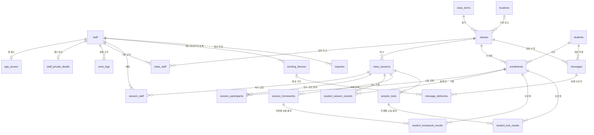

# Hongsi Supabase DB 설계

작성: 2026-09-13 · 브랜치: `codex/migrate-to-supabase`

이 문서는 `config/sheetConfig.ts`, 실제 화면의 조회·저장 코드, `google_apps_script`의 동작과 사용자가 확정한 입력·권한 규칙을 반영한 설계다. 2026-09-13 개발 프로젝트 `hongsi-dev`에 초기 구조와 Firebase 계정별 접근 SQL을 적용했다. 기존 시트 데이터 이전과 운영 배포는 아직 하지 않았다. 실제 적용 상태와 남은 인증 설정은 `docs/database-setup.md`에 기록한다.

## 결정한 내용

- 하나의 개발용 Supabase 프로젝트 안에서 업무 영역을 나눈다. 영역마다 DB를 만들지는 않는다.
- 사용자가 확인한 대로 **학생 ID는 모든 수업에서 공통**이다. 학생 기본정보는 한 번 저장하고 수강 관계로 여러 수업에 연결한다.
- 출석은 **학생 × 차시**, 숙제·시험 결과는 **학생 × 평가 항목**이다. 차시마다 숙제·시험이 각각 0개부터 여러 개까지 가능하며 컬럼을 추가하지 않는다.
- 출석 값은 `출석 / 영상 / 보강 / 결석`. 보강 날짜·시간·메모는 출석 값과 별도로 저장한다.
- 숙제 결과는 `A / B / C / 미제출`. 시험은 **항목별 만점**과 학생별 점수 또는 `결시`를 저장하며 점수·만점은 소수점 둘째 자리까지다.
- 학생별 기본 수신자는 `학부모만`이며, 요청받은 학생만 `학생·학부모 모두`로 바꾼다. 수업이 달라도 같은 설정이다.
- 메시지에는 **학생 전화번호와 학부모 전화번호를 모두** 보존한다. 실제 발송 대상과 결과는 수신자별로 분리한다.
- 조교의 직책, 담당 업무, 앱 접근 권한은 의미가 다르므로 합치지 않는다. 이름·이메일은 조교 기본정보에만 저장한다.
- 수업명·분기·요일·학생 수·조교 수 같은 반복/계산 가능한 값은 매 기록마다 복제하지 않는다. 반면 문자 내용·수신 연락처와 근무 당시 시급처럼 **과거 사실을 보존할 값**은 스냅샷으로 남긴다.
- 조교 출퇴근은 학생 출석과 별도 테이블이다. 학생 성적의 3년 보관 정책을 근무 기록에 적용하지 않는다.
- 승인된 조교도 **모든 수업의 학생 정보·출석·평가를 조회/입력**할 수 있다. 계정 승인·계좌 조회는 관리자만, 실제 문자 발송은 별도 등록/허용된 기기로 제한하는 정책을 다음 단계에서 구현한다.

## 전체 구성: 22개 테이블

테이블 개수보다 행 크기, 중복, 조회 범위와 인덱스가 용량·속도에 큰 영향을 준다. 두 대상을 연결하는 표는 대부분 두 ID만 가진다.

| 영역 | 테이블 | 역할 |
|---|---|---|
| 조교 | `staff` | 이름·이메일·전화번호·직책·담당 업무·재직 상태·입사일 |
| 조교 | `staff_private_details` | 계좌번호. 일반 조교 목록 조회와 분리 |
| 조교 | `app_access` | 조교별 앱 권한·승인 상태·기존 기기 ID |
| 조교 | `work_logs` | 실제 근무 시작·종료·당시 시급·비고 |
| 수업 | `locations` | 장소 이름·위도·경도·비고 |
| 수업 | `class_terms` | 앱에서 추가·이름 변경·비활성화하는 분기 목록 |
| 수업 | `classes` | 분기·학교·과목·기본 시간·장소·시급·활성 상태 |
| 수업 | `class_staff` | 수업의 기본 담당 조교 |
| 수업 | `class_sessions` | 날짜가 있는 개별 차시 |
| 수업 | `session_staff` | 각 차시에 배정된 조교 |
| 수업 | `students` | 공통 학생 ID·이름·학생/학부모 전화번호·이메일·기본 수신자 |
| 수업 | `enrollments` | 학생과 수업의 수강 관계 |
| 수업 | `session_participants` | 정식 수강을 바꾸지 않는 차시별 다른 반 보강 참여 |
| 수업 | `student_session_records` | 해당 학생·차시의 출석·보강 날짜/시간/메모 |
| 숙제 | `session_homeworks` | 차시에 실제로 부여한 숙제 항목명·설명·표시 순서 |
| 숙제 | `student_homework_results` | 학생별 해당 숙제의 A/B/C/미제출 |
| 시험 | `session_tests` | 차시에 실제로 시행한 시험 항목명·만점·설명·표시 순서 |
| 시험 | `student_test_results` | 학생별 해당 시험의 점수 또는 결시 |
| 메시지 | `messages` | 학생별 메시지 본문과 생성 당시 이름·두 전화번호 |
| 메시지 | `message_deliveries` | 학생/학부모 각각의 발송 상태 |
| 메시지 | `sending_devices` | 매니저·관리자가 등록/허용할 발송 기기 목록 |
| 문의 | `inquiries` | 작성자·내용·접수일·처리 상태·처리 담당자 |



## 학생 성적: 가로로 늘어나던 열을 행으로 바꾸기

현재 시트는 A~E에 학생 기본정보, FGH에 1차시, IJK에 2차시를 저장한다. 새 구조는 한 차시 안에서도 숙제·시험을 여러 개 등록할 수 있다. 예를 들어 C01 수업 3차시에 다음 항목을 만든다. 값은 설명용 가상 데이터다.

| 구분 | 항목명 | 만점 | 학생 0001의 결과 |
|---|---|---:|---|
| 출석 | 차시 출석 | 해당 없음 | 보강, 2026-09-20 14:30 예정 |
| 숙제 | 교재 숙제 | 해당 없음 | A |
| 숙제 | 프린트 숙제 | 해당 없음 | 미제출 |
| 시험 | 단원 시험 | 30.5 | 25.25 |
| 시험 | 단어 시험 | 10 | 결시 |

숙제/시험 항목명과 만점은 차시에 한 번만 저장하고, 학생별로는 항목 ID와 결과를 저장한다. 교재 숙제만 있는 날에는 프린트 숙제 항목을 만들지 않는다. 새 종류의 시험이 생겨도 테이블이나 컬럼을 추가하지 않고 항목만 등록한다.

학생 정보는 `students`, 수업은 `classes`, 날짜와 차시 번호는 `class_sessions`에 있다. 웹에서는 조회 결과를 다시 가로 표로 표시할 수 있으므로 익숙한 입력 화면을 만들 수 있다. 항목명 하나로 종류를 구분하며, 예를 들어 `교재 숙제`, `프린트 숙제`, `단원 시험`을 자유롭게 입력하고 범위/교재명 등은 설명에 적는다. 같은 차시에 이름이 같은 항목은 중복 등록하지 않으며, 구분이 필요하면 `프린트 1`, `프린트 2`처럼 이름을 구체화한다.

### 보강과 메모

- 출석 상태에는 항상 `보강`만 저장한다. `일 보강`처럼 요일이 섞인 상태 값을 늘리지 않는다.
- `makeup_date`는 실제 보강 예정일, `makeup_time`은 선택적인 예정 시각, `makeup_note`는 자유 메모다. 보강일을 알면 날짜로 저장하고 요일은 화면에서 계산해 `9/20(일) 14:30 보강`처럼 표시한다.
- 날짜를 아직 모르면 보강 상태와 `일요일 예정, 날짜 미정` 같은 메모만 저장할 수 있다. 시간이 있다면 날짜도 있어야 한다. 일반적인 기록 메모는 별도 `notes`다.
- 보강 정보가 남아 있는 상태에서 출석 값을 `출석/영상/결석/미입력`으로 바꾸려면 보강 필드도 함께 정리해야 한다. UI에서 한 번의 저장으로 처리한다.
- 날짜는 예정일이며 보강 완료를 뜻하지 않는다. 별도 완료 상태나 보강 수업 자동 등록 기능은 이번 요구에 포함하지 않았다.

### 수강 상태·전반·다른 반 보강

- 학생 ID는 분기별로 다시 만들지 않는다. `students.student_code`는 모든 분기와 수업에서 같은 학생을 가리키는 전역 ID다.
- `enrollments.enrollment_status`는 `active`, `transferred`, `withdrawn`만 저장하고 화면에서는 `수강 중`, `전반`, `퇴원`으로 표시한다.
- 같은 분기 전반은 이전 수강의 `ended_on`을 전반일 전날로 닫고 `transferred_to_class_id`를 남긴 뒤, 새 수업의 수강을 전반일부터 시작한다. 출석·숙제·시험 결과는 수업과 차시에 연결되어 있으므로 이전 반 기록이 이동하거나 복사되지 않는다.
- 다른 반에 한두 번 보강 오는 학생은 새 `enrollments` 행을 만들지 않는다. `session_participants`가 학생·원래 반 A·원래 차시·실제 보강 반 B·보강 차시를 연결한다. A/B 차시의 날짜 순서는 제한하지 않는다.
- 연결을 추가하면 A의 `student_session_records`에 `보강`과 B 차시 ID가 자동 저장된다. B에서는 해당 학생이 임시 보강 참여자로 보이고 출석·숙제·시험을 저장할 수 있다. 전체 학생 기록은 A와 B의 반·차시 연결을 모두 표시한다.
- 임시 보강 참여를 B에서 제거하면 B에 입력한 해당 학생의 출석·숙제·시험 결과와 A의 자동 보강 연결을 함께 정리한다. A에 수동으로 적은 일반 메모가 있으면 행은 남겨 메모를 보존한다.
- 기존 시트의 메모는 값 CSV만으로 가져올 수 있다고 가정하지 않는다. 이전 시 메모를 포함한 별도 추출을 준비하고, 날짜로 확실히 해석할 수 없는 원문은 메모로 보존한다.

### 시험 점수와 문자 평균

- 각 시험마다 만점을 필수로 입력한다. 시험 만점은 학생마다 반복 저장하지 않는다.
- 점수는 `0~해당 시험 만점`, 만점은 양수다. 점수·만점 모두 최대 소수점 둘째 자리까지 허용하며, 기술적인 상한은 `999999.99`다. 셋째 자리 이하의 유효 숫자를 자동 반올림해 저장하지 않고 입력 오류로 돌려준다.
- 정확한 십진수 `numeric`와 CHECK를 사용한다. `numeric(8,2)`가 초과 소수 자릿수를 저장 전에 반올림하는 동작을 피하기 위한 선택이다. [PostgreSQL numeric](https://www.postgresql.org/docs/current/datatype-numeric.html)
- 결시는 점수 없이 `결시`로 기록한다. 0점은 실제 점수이며, 미입력은 결과 행이 없는 상태다. 결시를 0점으로 바꾸지 않는다.
- **평균 계산의 기본안:** 같은 시험의 입력된 숫자 점수만 대상으로 평균을 계산하고 결시·미입력은 제외한다. 0점은 포함한다. 만점이 다른 시험들을 하나의 평균으로 섞지 않는다.
- 평균은 원래 점수로 계산한 뒤 소수점 둘째 자리로 반올림한다. 문자용 표시에서는 `17.01`, `8.00`처럼 두 자리를 표시한다. 점수가 하나도 없으면 평균은 `NULL`이고 화면/문자에서는 `—`로 표시한다. 결시 제외와 `—` 표시는 별도 요청이 없을 때의 기본안이다.
- 평균·최고점은 조회 시 계산하고 별도 중복 저장하지 않는다. 최종 문자 본문에 들어간 과거 평균은 본문 스냅샷으로 보존된다.
- 점수가 만점을 넘는 저장과 기존 점수보다 낮게 만점을 변경하는 작업을 DB 트리거가 거절한다. 시험 행 잠금으로 동시 만점 변경과 점수 입력을 조율하도록 구성했으며, 실제 Supabase에서 동시 요청 검증은 RPC 구현 단계에 수행한다. [PostgreSQL 행 잠금](https://www.postgresql.org/docs/current/explicit-locking.html)

### 데이터형과 무결성

- 기존 학생 ID는 `students.student_code`에 **문자열로 그대로 보존**한다. `0001`을 숫자 `1`로 바꾸지 않는다. 이름이나 가족이 공유하는 전화번호로 학생을 합치지 않는다.
- 내부 연결에는 8바이트 `bigint` ID를 쓴다. 외부 코드와 내부 키를 분리해 코드 변경이 전체 기록 수정으로 번지지 않게 한다. JavaScript에서는 큰 ID를 문자열로 취급하도록 API 타입을 정한다.
- `student_session_records`의 기본키는 `(session_id, student_id)`다. 숙제 결과는 `(homework_id, student_id)`, 시험 결과는 `(test_id, student_id)`이므로 같은 항목에 같은 학생의 결과가 중복되지 않는다.
- `class_id`는 연결 오류를 DB가 막도록 결과 표에 의도적으로 함께 둔다. 복합 외래키가 차시/평가 항목의 수업과 학생의 수강 관계를 검증한다. 다른 수업의 항목이나 수강하지 않은 학생을 연결하면 저장이 거절된다. 평가 결과의 차시는 항목에서 찾으므로 결과마다 차시 ID를 반복 저장하지 않는다.
- **항목 자체가 없음**은 그날 숙제/시험이 없다는 뜻, **항목은 있고 학생 결과가 없음**은 미입력이라는 뜻이다. 미제출·결시와 구분한다.
- 출석·평가 결과가 없는 미래 차시는 학생별 빈 기록을 미리 만들지 않는다. 실제 숙제/시험 항목만 등록하고 수강생을 LEFT JOIN해서 미입력 상태로 표시한다. 학기 중 입·퇴원은 수강 시작/종료일로 구분한다.
- 성적 보관기간은 입력/수정 시각이 아니라 **연결된 차시의 수업일**로 계산한다. 오래된 점수를 수정했다고 보관기간이 다시 시작되지는 않는다.

## 조교·앱 권한·근무 기록

`ASSISTANT_HEADERS`의 직책(CEO/실장/조교), 담당 업무(현장/자료 등), `PERMISSION_HEADERS`의 앱 권한(Admin/Manager/Assistant)은 서로 다른 값이다. 직책만으로 관리자 권한을 주지 않는다. 직책·업무의 작은 다중 선택 목록은 `text[]`로 보존하고, 조회하지 않는 배열에는 GIN 인덱스를 만들지 않는다.

| 기존 헤더 | 새 위치/처리 |
|---|---|
| 조교 성명, gmail, 전화번호 | `staff.full_name`, `email`, `phone` |
| 직책, 역할 | `staff.positions`, `duties` |
| 근무 시작 | `staff.started_on` |
| 조교 비고 | 재직 여부는 `employment_status`; 나머지 원문은 `notes` |
| 계좌번호 | `staff_private_details.bank_account` (문자열) |
| 권한표의 이름·이메일 | `staff_id`로 연결. 중복 저장 제거 |
| 권한, 상태, Device ID | `app_access.app_role`, `access_status`, `device_id` |
| 출근자 이름·이메일 | `work_logs.staff_id`로 연결 |
| 근무 일자, 출근 시간, 퇴근 시간 | `started_at`/`ended_at`에 날짜·시간대를 함께 보존 |
| 근무 시간, 출근/퇴근 상태 | 시작·종료에서 계산. 종료가 없으면 근무 중 |
| 근무의 수업, 수업 ID | `class_id`와 과거 표시용 `work_label` |
| 근무 분기·요일 | 수업/근무일에서 조회. 반복 문자열 제거 |
| 위치, 비고 | `checkin_location`, `notes` |

앱에 **수업과 무관한 근무를 관리자가 추가하는 기능**이 있어서 `work_logs.class_id`는 비워둘 수 있다. `work_label`은 필수다. 실제로 특정 차시와 연결되는 경우에만 `session_id`를 넣는다.

- 근무 시작·종료는 `timestamptz`다. 가져올 때 한국 시간을 `+09:00`으로 명시한다. 자정이 넘어 끝나는 근무도 표현한다.
- 근무일은 한국 시간의 시작일, 근무 분은 종료-시작에서 자동 계산한다. 앱에서 별도로 계산한 합계를 다시 저장하지 않는다. 기존 저장 합계가 계산값과 다르면 이전 보고서에서 검토한다.
- **조교당 종료되지 않은 근무는 최대 1건**이라는 부분 고유 인덱스를 둔다. 서로 다른 기기에서 동시에 출근 요청을 해도 중복이 허용되지 않는다.
- 시급은 수업의 현재 기본값과 근무 당시 값을 구분한다. 이미 저장한 근무의 시급을 현재 수업 시급으로 덮어쓰지 않는다. 과거 시급이 확인되지 않으면 `NULL`로 남긴다.
- 신규 앱 접근은 `pending`이다. 기존 승인 계정은 검증된 권한표에 따라 이전하고, 계정을 생성했다는 이유만으로 승인하지 않는다.
- Firebase UID는 UUID 형식이 아니므로 `firebase_uid text`로 연결한다. Firebase UID와 직원의 매핑은 관리자/검증된 서버에서 수행해야 한다. 사용자가 보낸 이메일이나 Device ID만으로 연결/승인하지 않는다.

## 수업과 일정

| 기존 헤더 | 새 위치/처리 |
|---|---|
| 수업 ID | DB가 자동 생성하는 `classes.id`를 모든 관계와 앱 경로에서 사용 |
| 분기, 학교, 과목 | `term_label`, `school`, `subject` |
| 요일 | `classes.weekdays` (일=0 … 토=6). 실제 차시 요일은 날짜에서 계산 |
| 장소, 좌표, 비고 | `locations`로 분리하고 ID로 연결 |
| 시작, 종료 | `classes.default_start_time`, `default_end_time` |
| 시급 | `classes.default_hourly_rate_krw` |
| 학생 수, 조교 수 | 수강 관계·담당 관계의 COUNT. 저장하지 않음 |
| 수업 근무자 | `class_staff` |
| 일정의 수업 ID, 차시, 날짜, 비고 | `class_sessions` |
| 일정의 예정 근무자 | `session_staff` |
| 수업 CSV URL, 마스터 시트 URL | 이전 시 입력 자료로만 사용. 새 업무 테이블의 연결 키에서 제거 |

차시마다 바뀌는 시간/장소는 `class_sessions`에 넣는다. 차시 시간/장소가 비어 있으면 현재 수업 기본값을 사용한다. 기본값 변경이 과거 화면에도 반영되는 의미이므로, 역사적 일정 보존이 필요하면 차시 생성 시 확정 값을 채워 넣는다.

기본 담당 조교는 차시를 만들 때 `session_staff`에 명시적으로 복사한다. 이후 기본 담당을 바꿔도 이미 배정된 차시의 담당자는 바뀌지 않는다. 차시 담당 표가 비어 있으면 미배정이며, 조회 때 임의로 기본 담당으로 채우지 않는다.

같은 수업·같은 차시 번호는 하나뿐이고, 같은 날짜에 여러 차시를 열 수 있다. 차시 번호와 날짜가 바뀌어도 내부 ID로 연결한 성적은 유지된다. 기록이 연결된 차시는 단순 삭제가 거절된다.

## 메시지: 두 연락처와 수신자별 상태

`messages` 한 행은 한 학생에게 작성한 최종 메시지다. `student_phone_snapshot`과 `parent_phone_snapshot`에 생성 시점의 두 번호를 담는다. 실제 발송 대상을 `message_deliveries`에 명시한다.

`students.default_message_recipients`에 학생별 기본 수신자를 저장한다. `parent`는 학부모만(신규 기본값), `both`는 요청받은 학생·학부모 모두다. 수업별 설정은 두지 않는다. 메시지 작성 API가 이 값을 읽어 대상을 선택하고, 최종 확인된 수신자를 발송 행으로 저장할 예정이다. **이 필드 자체가 자동으로 발송 행을 만드는 것은 아니다.** 발송 전에 수신자를 명시적으로 변경하는 기능은 기존 제안대로 구현하며, 학생만 보내는 개별 메시지도 발송 테이블에서 표현 가능하다.

연락처가 없는데 해당 대상을 선택한 경우 오류를 표시한다. 다른 사람의 번호로 임의 대체하지 않는다. 기본 수신자나 연락처를 나중에 수정해도 이미 만들어진 메시지의 수신자·번호는 바뀌지 않는다.

예: 메시지 501번에 학생·학부모 모두 선택 시 `(501, student)`, `(501, parent)` 두 행을 만든다. 학부모에게만 보낼 경우 parent 한 행만 만든다. 전화번호가 두 개 있다고 자동으로 두 건을 발송하지 않는다. 두 번호가 같을 때 실제 중복 발송 여부는 발송 전 검토에서 처리해야 한다.

- 메시지 본문은 두 수신자가 공유한다. 학생과 학부모의 문구가 다르면 별도 메시지를 만든다.
- 실제 목적지는 메시지의 해당 전화번호 스냅샷에서 읽는다. 발송 표에 같은 번호를 또 저장하지 않는다.
- 학생 연락처가 바뀌어도 과거 메시지의 번호는 바뀌지 않는다. 메시지 스냅샷은 DB 트리거로 수정 금지한다. 발송 대기 메시지를 고칠 때는 취소 후 새 메시지를 만든다.
- 기존 수업명·분기·요일은 수업/차시에서 조회한다. 본문 자체는 최종 문자열로 보존하므로 템플릿 변경의 영향을 받지 않는다. 로그의 수업 표시명은 현재 수업 정보를 따른다.
- 메시지의 학생은 해당 수업의 수강 관계가 있어야 한다. 선택한 차시가 다른 수업 소속이어도 DB가 거절한다. 과거 메시지의 수강 관계는 종료일을 남겨 보존한다.
- 기존 코드에는 한 수업의 미발송 문자를 일괄 `sent`로 바꾸는 동작이 있다. 새 API에서는 **수신자별 결과만** 업데이트해야 한다.
- 상태: `pending` → `sending` → `submitted` 또는 `failed`. `submitted`는 발송 시스템에 넘겼다는 뜻이며 실제 수신 완료를 보장하지 않는다. 발송 도중 앱이 중단되어 결과를 모르면 `unknown`으로 구분한다. 자동으로 다시 보내 중복 발송하지 않는다.
- 오래된 시트의 `sent`는 실제 개별 성공 여부를 보장할 수 없어 `legacy_sent`로 이전한다. 임의의 발송 시각을 만들지 않는다.
- `messages.request_id`는 같은 생성 요청을 재시도할 때 재사용한다. 매번 새 UUID를 만들면 중복 방지 효과가 없다. 같은 키의 다른 본문은 API에서 오류 처리한다.
- 발송 선점·상태 전이·권한 검사는 후속 서버/RPC 작업이다. 생성 SQL만으로 여러 기기의 문자 발송을 제어하는 완성된 큐가 되는 것은 아니다.
- 기존 메시지에는 생성일·발송일 헤더가 없다. `created_at`에 이전 시점을 넣는 경우 이를 가져온 시점으로 취급하고, `import_key`로 기존 데이터임을 식별한다. 날짜를 근거 없이 추정해 삭제 정책에 포함하지 않는다.

### 발송 기기

- `sending_devices`에 기기 ID, 표시 이름, 허용 여부, 등록자를 저장한다. 새 기기는 기본적으로 비활성 상태이며, **매니저와 관리자 모두** 등록/허용/차단할 수 있다. 이 정책은 두 번째 마이그레이션에 반영했다. 등록자는 DB가 로그인한 조교 ID로 기록하며 클라이언트가 다른 등록자로 위장할 수 없다.
- `message_deliveries.sending_device_id`에 실제 발송을 담당한 기기를 연결할 수 있다. 과거 메시지처럼 기기를 확인할 수 없는 경우는 비워둔다. 허용을 해제해도 과거 기록을 위해 기기 행은 보존한다.
- **사용자의 계정 권한과 기기의 발송 권한은 별개다.** 서버는 승인된 로그인과 허용된 기기의 인증을 함께 검사해야 한다. 기기 ID 문자열이나 클라이언트의 `isAdminDevice` 값만 믿고 발송을 허용하지 않는다.
- `app_access.device_id`는 기존 권한표 값의 보존용이다. 이전한 Android ID를 자동으로 신뢰하거나 기기를 활성화하지 않는다. 실제 기기 인증 수단과 발송 선점/결과 갱신 RPC는 Firebase 연동 다음 단계에서 구현한다. 현재 기기 목록 생성만으로 실제 발송이 보호되는 것은 아니며, 메시지 생성·발송 상태의 직접 쓰기 권한은 닫혀 있다.

## 문의

`INQUIRY_HEADERS`의 ID는 `import_key`에 출처와 함께 보존하고, 새 기본키는 DB가 발급한다. 날짜는 `created_at`, 내용은 `content`, X/O는 open/resolved로 변환한다. 이름·이메일은 작성 조교의 `staff_id`로 연결한다.

신규 문의에는 처리일·처리자를 남길 수 있다. 기존 문의의 O 상태에 처리 시각·담당자가 없으면 이를 `NULL`로 보존한다. 문의 작성자가 기존 조교 표에 없으면 이전 보고서에 남기고 명시적으로 계정을 매핑한다.

## 성능·용량 원칙

1. 수업 상세는 선택한 수업 ID로, 일정은 날짜 범위로, 성적은 선택한 차시/학생으로 제한해 조회한다. 전체 DB를 받아 브라우저에서 필터링하지 않는다.
2. 한 차시의 학생 표는 수강생·학생·기록을 묶어 한 번에 조회한다. 숙제와 시험은 각각 먼저 집계해 서로 곱으로 늘어나는 JOIN을 방지한다. 응답에 JSON 배열을 사용해도 DB 저장은 개별 행이다. 학생마다 API를 호출하는 패턴을 만들지 않는다.
3. PK/UNIQUE가 이미 만드는 인덱스는 중복해서 만들지 않는다. 추가 인덱스는 날짜/수업/학생/조교 조회 또는 외래키 검사에 사용한다. 메시지 대기·미해결 문의·열린 근무에는 부분 인덱스를 쓴다.
4. 이름·분기·전화번호를 학생 기록마다 반복 저장하지 않는다. 학생·조교 수와 근무 합계는 계산한다. 작은 분기/과목 문자열을 별도 사전 테이블로 무리하게 쪼개지는 않는다.
5. 성적을 거대한 JSON 한 덩어리로 저장하지 않는다. 특정 차시만 수정하고 집계·보관기간 정리를 할 수 있는 행 구조를 쓴다.
6. 메시지 본문과 변경/문자 이력은 점수 숫자보다 용량이 커질 수 있다. 성적 정리만으로 DB 전체가 일정 크기를 유지한다고 가정하지 않는다.
7. 파티셔닝, 별도 캐시 서버, 실시간 구독, 모든 컬럼 인덱스는 초기 단계에서 도입하지 않는다. 실제 쿼리와 실행계획을 보고 추가한다.
8. 500MB는 표 데이터뿐 아니라 인덱스·기타 DB 데이터도 사용하는 한도다. 이 테스트의 가상 데이터 측정은 실제 용량 보장이 아니다.

## 3년 보관과 삭제

현재 단계에서는 자동 삭제 작업을 만들지 않는다. 우선 `supabase/queries/diagnostics.sql`로 수업일 기준 3년을 초과한 학생 기록의 건수만 확인한다. 보관 경계는 한국 날짜를 기준으로 **3년 전 날짜보다 오래된 기록**이며, 경계일 기록은 남긴다.

실제 정리 시 수업일을 기준으로 `student_session_records`, `student_homework_results`, `student_test_results`의 오래된 학생 결과 행을 대상으로 한다. 숙제·시험 결과의 수업일은 항목을 거쳐 차시에서 찾는다. 학생 기본정보·수강 관계·차시·평가 항목 정의·조교 근무·문의·문자 기록은 자동 연쇄 삭제하지 않는다. 다른 기록의 보관 기준은 별도로 정해야 한다. 현재 외래키는 대부분 RESTRICT이고, 메시지 삭제 시 그 메시지의 수신자 행만 CASCADE된다.

삭제 후 PostgreSQL은 공간을 즉시 OS에 반환하지 않을 수 있다. 일반 VACUUM/자동 정리 후 빈 공간을 재사용하는 것과 표시되는 파일 크기 감소는 다르다. 운영 중 `VACUUM FULL`을 무조건 실행하지 않는다.

## 이전 절차와 검증

1. 원본을 백업하고, 원본 파일·민감 데이터는 Git에 넣지 않는다. 로컬 작업 경로는 무시되는 `supabase/.local/`을 쓴다.
2. 조교·권한표는 정규화한 이메일로 대응하되 충돌을 보고한다. 재직 상태와 앱 승인 상태는 별개로 이전한다.
3. 학생은 전역 학생 코드로 대응한다. 서로 다른 수업에 같은 코드가 있지만 연락처/이름이 다르면 최신이라고 추정해 덮어쓰지 않고 충돌 목록을 만든다.
4. 수업 코드 중복, 연도가 빠진 분기, 근무자 이름의 동명이인, 잘못된 날짜·좌표를 검증한다. 관련 코드가 없는 근무는 `work_label`로 보존할 수 있다.
5. 차시 n의 시작 열 인덱스는 `5 + (n - 1) * 3`(0부터)이다. 출석은 차시 기록, 숙제·시험은 항목과 학생 결과로 변환하고 학생 기본정보를 차시마다 복사하지 않는다. 과거 한 셀에 여러 항목이 섞였으면 구분 규칙을 확인한다. 시험 만점을 근거 없이 100점으로 넣지 않고, 만점·항목 종류가 불명확하면 이전 보류 목록에 원문을 보존한다. `20/30` 같은 값도 검증된 규칙으로 점수/만점을 분리해야 한다. 시트 메모는 별도로 추출해 보강 정보와 연결한다.
6. 성적이 있는 차시의 날짜/일정이 없으면 이전 보류 목록을 만든다. 오늘 날짜를 넣거나 성적을 버리지 않는다. 클래스 시트와 마스터 시트의 중복 기록은 하나의 기준 원본을 정한다.
7. 메시지의 기존 student ID는 전역 학생 코드로 연결한다. 옛 학생 전화번호는 메시지 원본에 없으므로 과거 발송 번호라고 추정해 채우지 않는다. 신규 메시지는 두 번호를 스냅샷으로 담는다.
8. 반복 가져오기용 `import_key`는 원본 스냅샷의 식별자와 안정적인 행 식별자를 조합한다. 실시간 시트의 변경 가능한 행 번호만 키로 쓰지 않는다. 출석은 학생/차시, 숙제·시험 결과는 학생/평가 항목 고유키로 대조한다. 별도의 요청 기록이 없는 기존 학생의 기본 수신자는 학부모만으로 시작하고, 확인된 요청만 both로 반영한다.
   내부 identity ID는 DB가 발급하도록 두고 반환된 ID를 연결에 사용한다. 별도 복구 작업에서 명시적인 ID를 넣었다면 identity sequence도 최대 ID 이후로 맞춰야 한다.
9. 원본/이전 후 학생 수, 수강생 수, 차시별 기록 수, 점수 합계, 출퇴근 분 합계, 메시지·문의 건수와 상태를 비교한다. 미확정 항목과 값 변환은 보고서로 남긴다.
10. 개발용 DB에 먼저 적용하고, 로그인·RLS·웹/모바일 입력·발송 결과 처리를 구현한 후 운영 전환한다. 앱 배포 되돌리기만으로 DB 데이터가 되돌아가지는 않는다.

## 적용 범위와 다음 단계

생성 SQL: `supabase/migrations/20260913000100_initial_schema.sql` → 접근 권한 SQL: `20260913000200_firebase_access.sql` → 수업 코드 제거 SQL: `20260923000300_remove_class_code.sql` → 학생/차시 기록 RPC: `20260924000400_student_records_rpc.sql` → 기존 학생 정보 보존 보완: `20260924000500_preserve_existing_student_details.sql` → 학생 연락처 검증·ID 자동 생성·차시 전체 저장: `20260925000600_bulk_records_and_student_validation.sql` → 분기·수업·차시 관리와 평가 항목 삭제: `20260925000700_class_catalog_and_session_items.sql` → 수강 상태·전반·차시별 다른 반 보강·예정 근무자 선택: `20260926000800_enrollment_moves_makeups_and_session_staff.sql` → 전반 이력 직접 재개 차단: `20260926000900_restrict_enrollment_reactivation.sql` → A/B 보강 차시 직접 연결: `20260926001000_link_makeup_sessions.sql`

- 트랜잭션 안에서 테이블·인덱스·제약조건·트리거를 만든다. 기존 업무 테이블을 삭제하지 않으며, 같은 이름이 이미 있으면 실패한다. 임의로 IF NOT EXISTS를 추가해 서로 다른 구조를 혼합하지 않는다.
- 첫 파일은 **20개 테이블 모두 RLS ON, 클라이언트 허용 정책 없음**으로 시작한다. 두 번째 파일이 검증된 Firebase UID·DB 승인 상태·역할을 기준으로 54개 정책과 열 단위 권한을 추가한다. 익명 사용자, 미등록/미승인/중지/비활성 계정은 업무 데이터에 접근할 수 없다.
- 현재 구현한 범위는 역할별 조회·일반 입력, 변경자 자동 기록, 관리자 전용 계정 승인 RPC, 매니저/관리자 기기 관리, 원자적인 학생 등록·수강 배정, 전반·수강 종료/재개, 차시별 다른 반 보강 참여, 예정 근무자 선택, 차시 전체 기록 저장이다. 기존 전역 학생 코드를 다른 수업에 배정할 때 연락처와 기본 수신 설정은 보존하며, 배정 후 수업 상세의 학생 정보 화면에서 명시적으로 바꿀 수 있다. 빈 학생 ID는 자동 생성하고, 전화번호·이메일은 DB 쓰기 직전에도 검사한다. 차시 기록 RPC는 정식 수강생과 해당 차시의 임시 보강 학생을 한 트랜잭션으로 저장하며 숙제·시험 결과를 `미입력`으로 되돌리는 제한된 삭제도 처리한다. 조교 출퇴근, 메시지 생성/발송·실제 기기 인증은 후속 RPC/UI 작업이다. 일반 클라이언트의 직접 삭제 권한은 계속 닫혀 있다.
- 이미 SQL로 적용한 마이그레이션 파일은 수정하지 않고 새 파일로 변경한다. SQL Editor 수동 실행과 CLI 적용을 섞을 때는 CLI migration history도 일치시킨다.
- `hongsi-dev` 초기 적용 시 테이블 20개·RLS 20개·정책 54개·직원 0명·학생 0명을 확인했고, 2026-09-20 검증된 Firebase 계정에 연결된 첫 관리자 직원 1명을 추가했다. 적용 파일은 SQL Editor로 수동 실행했으므로 이후 CLI를 도입할 때 migration history를 먼저 동기화해야 한다. 2026-09-23 `class_code`를 제거해 `classes.id`로 식별자를 통일했고, 2026-09-24 학생/차시 기록 RPC, 2026-09-25 연락처 검증·차시 전체 저장·분기/수업/차시 관리 RPC, 2026-09-26 수강 이동·A/B 보강 차시 연결·차시 근무자 RPC를 적용했다. 현재 테이블은 22개이며 모두 RLS가 켜져 있다. 개발 환경에서는 계정 권한 확인, 수업·위치·차시 조회, 수업별 학생 관리와 표 형식 기록 입력을 Supabase에 연결했다. 운영 환경은 데이터 소스 환경변수를 바꾸기 전까지 Google Sheets를 사용한다.

로컬 검증:

```powershell
cd D:\Workspace\hongsi\supabase\tests
npm ci
npm test
```

기본 테스트는 PGlite의 메모리 내 PostgreSQL에서 실행하며 실제 문자를 발송하지 않는다. `schema.test.mjs` 30개와 `access.test.mjs` 24개가 통과했다. 학생 등록/배정 권한, 빈 학생 ID 자동 생성, 연락처 검증·정규화, 기존 학생의 전역 연락처 보존, 전반 뒤 이전 수강 보존, 임시 보강 학생의 기록 저장/제거, 차시 근무자 선택, 개별/전체 기록의 원자적 저장, 분기 이름 연쇄 변경, 수업 보관, 차시 묶음 생성, 숙제·시험 항목의 결과 포함 삭제도 검증한다. 추가로 `development-readonly.mjs`를 실행해 실제 개발 API에서 6개 테이블과 15개 RPC의 익명 접근 차단(총 21개, 각 HTTP 401)을 확인했다. 2026-09-20 `verify-firebase-access.mjs`로 실제 Firebase ID 토큰의 개발 API 관리자 조회도 검증했다. 조교·매니저의 실제 로그인 세션과 동시 네트워크 쓰기는 별도 통합 검증이 필요하다.

2026-09-13 로컬 검증 결과: **30개 테스트 통과**. 생성 SQL, 전역 학생 ID, 출석 네 가지 값과 보강 필드, 복수 평가 항목, A/B/C/미제출, 0점·결시·미입력, 소수 자릿수/만점 검증, 학생별 기본 수신자, 독립된 기기 목록, 잘못된 수업 연결/삭제 차단, RLS/권한 차단, 세 종류 기록의 보관 대상 조회, 한 차시 묶음 조회 및 시험별 평균을 검증했다. 평균 예제는 0·25.50·25.52와 결시/미입력을 함께 두어 `17.01`이 되고, 별도 시험 평균은 `8.00`이 되는지 확인한다.

용량 예시 측정은 학생 100명 × 차시 100개 × (출석 1 + 숙제 2 + 시험 2)의 가상 데이터와 기능 검증용 소량 데이터를 사용했다. 출석 10,002행, 숙제 결과 20,003행, 시험 결과 20,005행과 숙제/시험 항목 정의를 합친 다섯 테이블의 할당 공간은 4,128,768바이트, 인덱스는 3,694,592바이트로 합계 **7,823,360바이트(약 7.46MiB)**였다. 이전 단일 성적 테이블의 측정치는 현재 구조에 적용하지 않는다. 이 수치에는 학생·수강 관계·수업·차시·조교·문자 등 다른 표와 장문 메모, 실제 수정 누적이 포함되지 않는다. 500MB를 몇 년 쓸 수 있는지 보장하는 예측이나 성능 벤치마크가 아니다.

### 확정된 접근 범위와 후속 구현

아래는 사용자 수정 사항을 반영한 최종 구현 기준이다. 일반 조회/입력·계정 승인·기기 관리 정책은 두 번째 SQL에 적용했다. 표의 출퇴근, 메시지 작성/발송처럼 전용 RPC가 필요한 동작은 아직 구현 전이다. 승인 대기/중지 계정에는 업무 데이터 접근을 허용하지 않는다.

| 데이터/동작 | 조교 | 매니저 | 관리자 |
|---|---|---|---|
| 조교 기본정보, 수업·일정 | 업무에 필요한 목록 열람 | 관리 | 관리 |
| 계좌정보 조회·관리 | 불가 | 불가 | 허용 |
| 계정 승인·중지·역할 변경 | 불가, 본인 상태 열람 | 불가, 본인 상태 열람 | 관리, 직접 본인 권한 변경 금지 |
| 학생 정보·연락처·기본 수신자 | **모든 수업 조회/입력** | 전체 관리 | 전체 관리 |
| 출석·보강·숙제·시험 결과 | **모든 수업 조회/입력** | 전체 관리 | 전체 관리 |
| 차시별 숙제·시험 항목/만점 | 모든 수업 조회/입력 | 전체 관리 | 전체 관리 |
| 근무 기록 | 본인 열람·검증된 출퇴근 | 전체 조회·수정/추가 | 전체 조회·수정/추가 |
| 메시지 작성 | 담당 수업 범위 | 전체 수업 | 전체 수업 |
| 발송 기기 등록·허용·차단 | 불가 | 허용 | 허용 |
| 실제 문자 발송·상태 갱신 | 승인된 로그인 + 허용된 기기 인증 + 발송 RPC | 같은 조건 | 같은 조건 |
| 문의 | 본인 작성·열람 | 전체 열람·처리 | 전체 열람·처리 |

계좌정보는 본인 계좌도 일반 조교 권한으로 조회하지 않는다. 메시지 작성 범위는 기존 제안인 담당 수업 범위로 두며, 이번에 명시적으로 넓힌 학생 정보·출석·평가 입력 권한과 구분한다. 조교에게 모든 수업의 조회/입력을 허용해도 전체 수업/학생/과거 기록 삭제 권한을 자동으로 부여하지 않는다. 차시 담당자 배정은 업무 배정·근무 관리를 위한 정보이며 학생 데이터 조회를 제한하는 조건으로 사용하지 않는다.

직접 테이블 UPDATE 권한만으로 출퇴근, 역할 변경, 메시지 발송 처리를 열지 않는다. DB는 검증된 Firebase JWT의 subject에서 조교를 식별한다. 재직 상태가 접근 허용에 영향을 주므로 매니저는 재직 상태 변경으로 계정 중지/승인 제한을 우회할 수 없고, 해당 변경은 관리자만 가능하다. Firebase JWT의 `role: authenticated` 설정은 로컬 관리자 도구에서 처리하며 앱 역할(admin/manager/assistant)은 별도로 DB에서 결정한다.

## 참고한 공식 문서

- [PostgreSQL 제약조건](https://www.postgresql.org/docs/current/ddl-constraints.html)
- [Supabase 인덱스](https://supabase.com/docs/guides/database/postgres/indexes)
- [Supabase Firebase 인증 연동](https://supabase.com/docs/guides/auth/third-party/firebase-auth)
- [Supabase RLS](https://supabase.com/docs/guides/database/postgres/row-level-security)
- [Supabase DB 크기](https://supabase.com/docs/guides/platform/database-size)
- [PGlite](https://pglite.dev/docs/)
